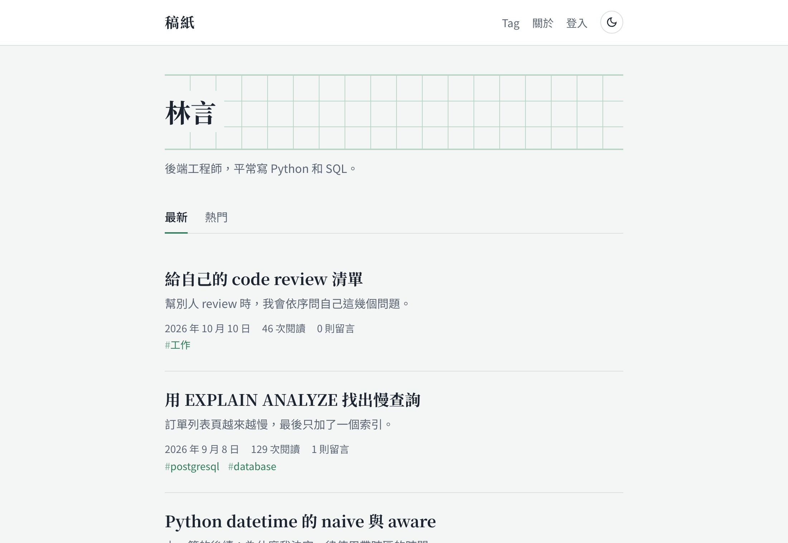
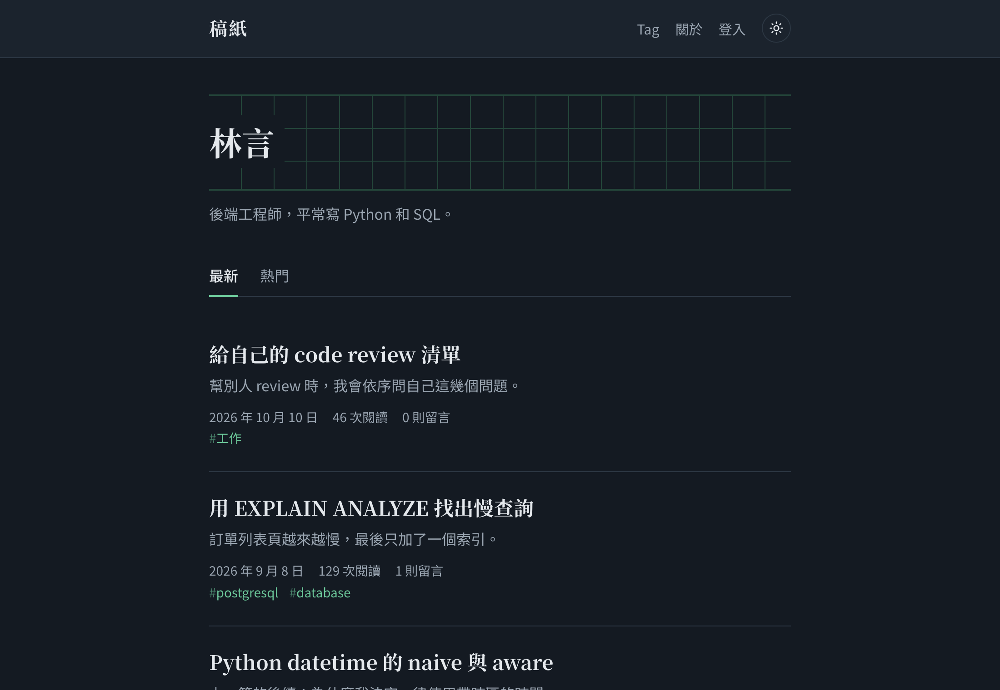
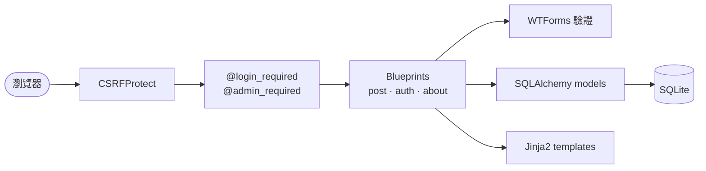
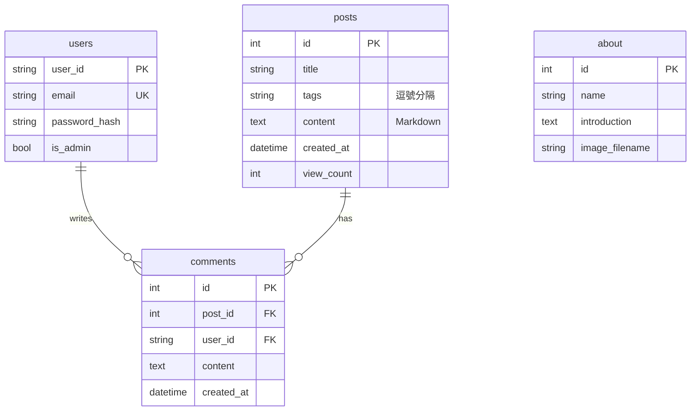

# Personal Blog

Flask 寫的個人部落格：文章、tag、留言、後台管理，文章支援 Markdown。

2024 年 4 月的期末專題，兩人合作。我負責專案骨架（models、forms、路由）、註冊登入、權限控管和「關於我」頁面；組員負責文章相關功能（首頁、發文與編輯、留言、tag 頁）和 CSS。

2026 年我自己把整個專案重構了一次，下面「重構時修掉的問題」是這次的主要內容。

| 淺色 | 深色 |
| --- | --- |
|  |  |

## 執行

需要 [uv](https://docs.astral.sh/uv/getting-started/installation/)。

```bash
uv sync
uv run flask --app main seed-demo   # 建立示範資料
uv run python main.py               # http://127.0.0.1:6002
uv run pytest
```

示範帳號：管理員 `linyan`、一般會員 `mia_chen`，密碼都是 `demo-pass!`。示範文章和人物都是虛構的。
正式使用時改用 `uv run flask --app main create-admin` 建立管理員，並設定環境變數 `SECRET_KEY`。

## 重構時修掉的問題

| 問題 | 修正 | 對應測試 |
| --- | --- | --- |
| 密碼明文存在資料庫 | 改用 Werkzeug 的雜湊 | `test_register_stores_hashed_password` |
| 管理員寫死成 `user_id == "coffee"`，誰先註冊這個 ID 誰就是管理員 | 改成 `is_admin` 欄位，只能用 `flask create-admin` 建立 | `test_create_admin_command` |
| 發文頁完全沒檢查權限；編輯「關於我」的 `redirect()` 少了 `return`，等於沒擋 | 統一用 `@admin_required` | `test_reader_cannot_use_admin_pages` |
| 刪除文章用 GET 連結，被爬蟲或預先載入就會誤刪 | 改成 POST，全站開 CSRF | `test_delete_requires_post_method` |
| 編輯文章的實作是「刪掉再新增」，瀏覽數會歸零 | 改成原地更新 | `test_admin_edit_keeps_id_and_views` |
| 上傳大頭貼時迴圈變數蓋掉了 `filename`，圖片存成錯的檔名 | 用 UUID 存檔，並刪掉舊圖 | `test_new_picture_replaces_old_one` |
| tag 用 `LIKE '%tag%'` 查詢，`py` 會搜到 `python` | 先粗篩再精確比對 | `test_tag_filter_is_exact` |
| 沒登入就進後台或留言會 500；不存在的文章也是 500 | 導向登入頁／回 404 | `test_comment_requires_login`、`test_missing_post_is_404` |

其他改動：

- 改用 Application Factory（`create_app`），原本 `route.py` 只是轉呼叫 `controllers/`，合併成三個 Blueprint
- 文章內容支援 Markdown，輸出前用 nh3 白名單清掉 `<script>` 等內容（`test_article_strips_dangerous_html`）
- `requirements.txt` 換成 uv，Flask 3.0 → 3.1、SQLAlchemy 2.0 → 2.1
- 介面重做，加了深色模式；刪掉 8 個沒用到的 CSS 檔

目前有 32 個測試，涵蓋註冊登入、權限、文章 CRUD、留言、tag、上傳和 Markdown。

## 架構





```text
personalBlog/
├── __init__.py      create_app、錯誤頁、CLI 指令
├── config.py
├── extensions.py    db、csrf、login_manager
├── decorators.py    @admin_required
├── forms.py
├── rendering.py     Markdown 轉換與清洗
├── demo.py          seed-demo 示範資料
├── models/
├── views/           auth、post、about 三個 Blueprint
├── templates/
└── static/
tests/
```

## 還可以改的地方

- tag 目前存成逗號分隔字串，資料多了應該拆成獨立的表，用多對多關聯
- 文章列表沒有分頁
- 沒有 migration，改 schema 要重建資料庫（應該導入 Flask-Migrate）
