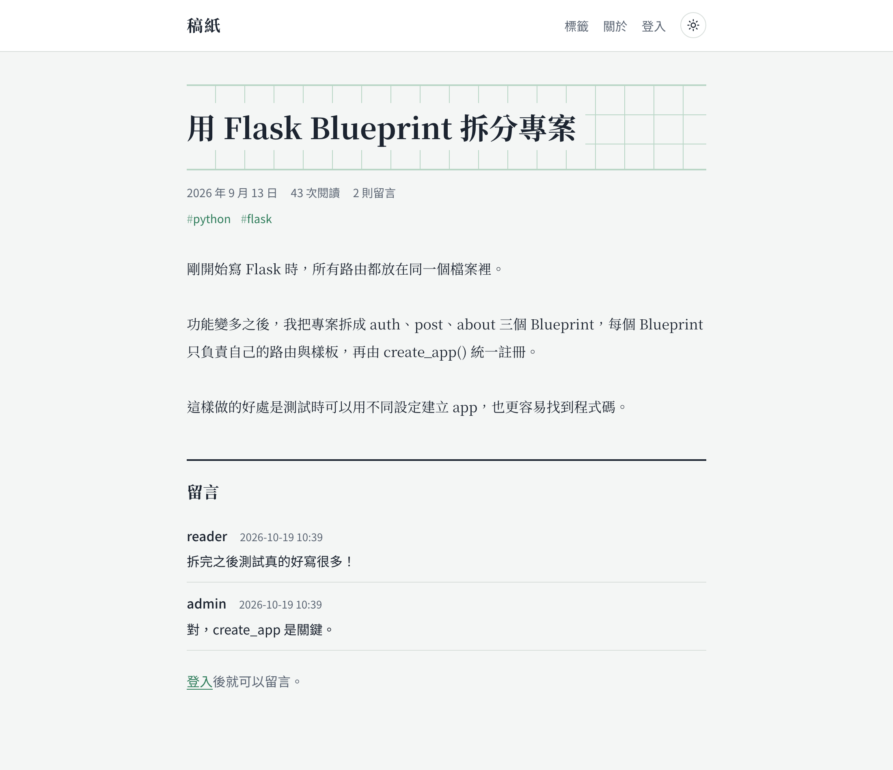
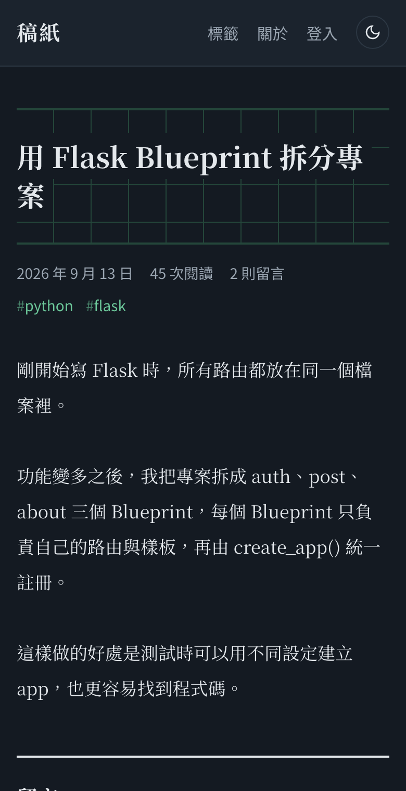
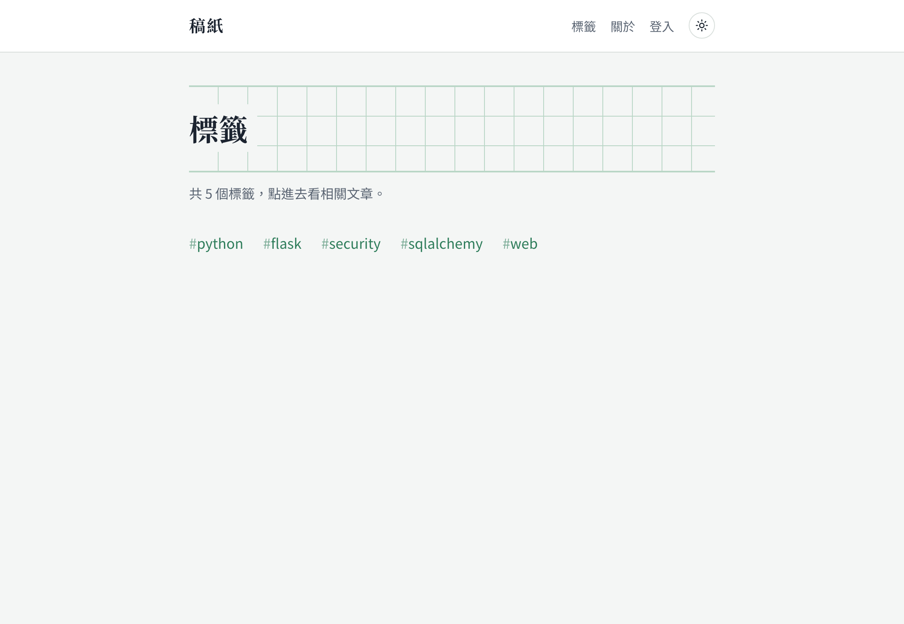
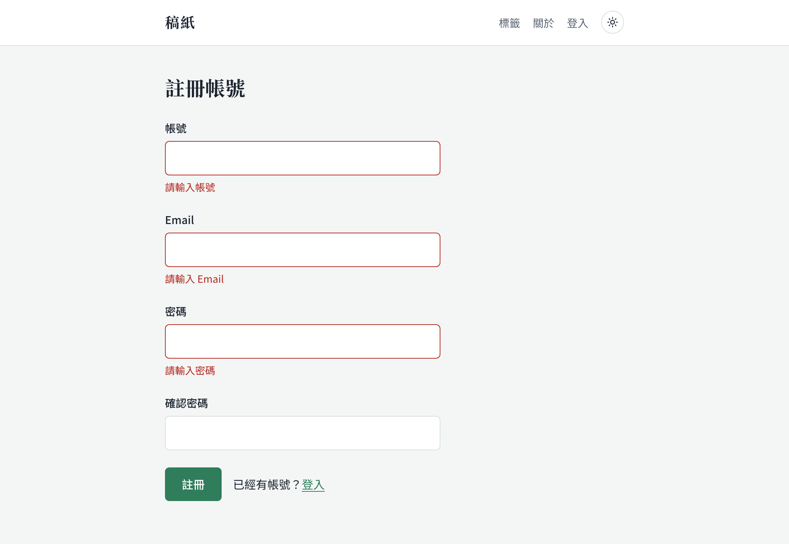
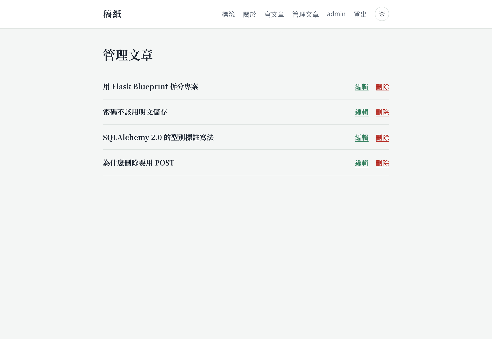
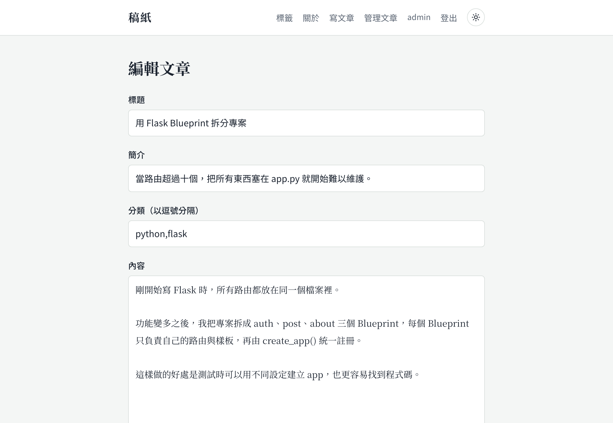
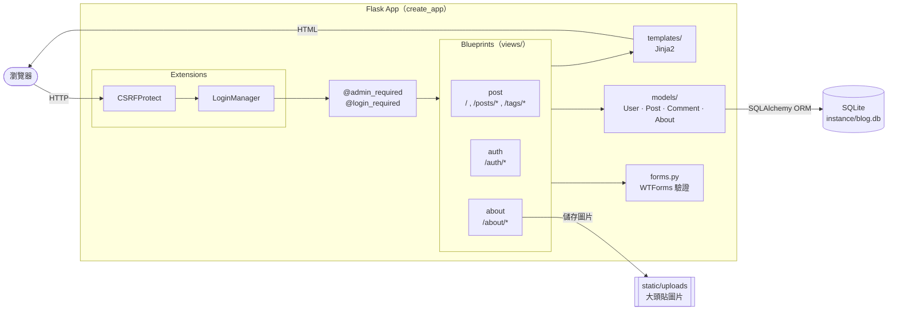
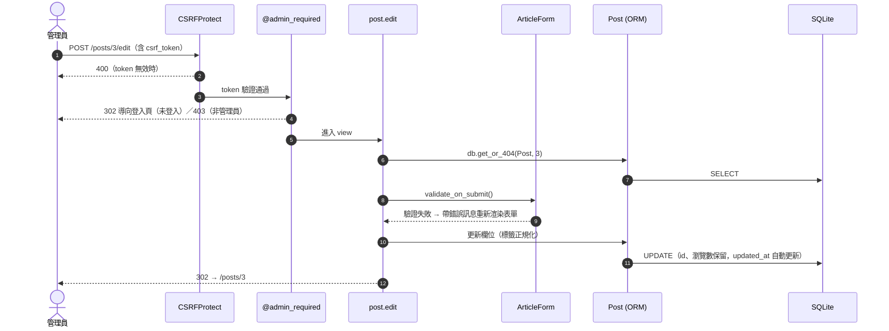
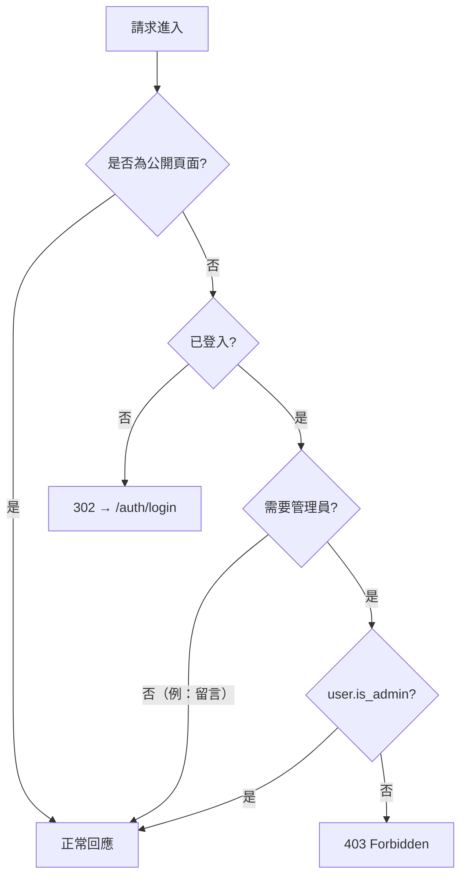
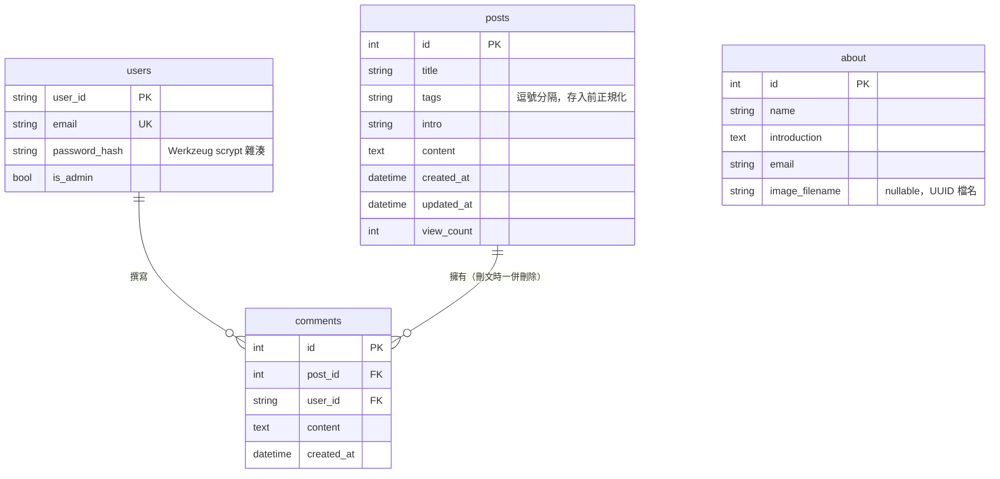

# 稿紙 · Personal Blog

以 **Flask** 打造的個人部落格系統，支援文章發表／編輯、標籤分類、留言、瀏覽數統計與「關於我」頁面，並提供淺色／深色兩種主題。
採用 Application Factory + Blueprint 架構，並以 pytest 覆蓋主要流程。

> 原本是兩年前的期末專題，2026 年重新整理：重構專案結構、修正安全性問題、補上測試、重新設計 UI，並改用 [uv](https://docs.astral.sh/uv/) 管理環境。

<table>
  <tr>
    <td></td>
    <td></td>
  </tr>
  <tr>
    <td align="center">淺色模式</td>
    <td align="center">深色模式</td>
  </tr>
</table>

## 功能介紹

### 閱讀文章

首頁提供 **推薦／最新／熱門** 三種排序，熱門依瀏覽數排列。每篇文章顯示發布日期、閱讀次數、留言數與標籤；點進文章後瀏覽數自動 +1。
標題底下的稿紙格線是整個網站的視覺主軸，呼應「稿紙」這個名字。

<table>
  <tr>
    <td width="66%"></td>
    <td width="34%"></td>
  </tr>
  <tr>
    <td align="center">文章頁與留言</td>
    <td align="center">手機版（深色）</td>
  </tr>
</table>

### 淺色／深色模式

- 預設跟隨作業系統的 `prefers-color-scheme`
- 右上角按鈕可手動切換，選擇會存在 `localStorage`，重新整理後保留
- 主題切換腳本放在 `<head>` 最前面，載入時不會先閃一下錯誤的顏色
- 所有顏色集中在 CSS 變數（design token），兩種主題只需替換一組變數

### 標籤分類

發文時以逗號輸入標籤（例如 `python, flask`），系統會自動去除空白與重複。標籤頁列出所有標籤，點進去只會顯示**完全符合**的文章。



### 會員與留言

訪客可以自由閱讀，註冊登入後才能留言。註冊表單會即時檢查帳號／Email 是否重複與密碼強度（至少 8 個字元、包含英文字母與特殊字元），錯誤訊息直接顯示在欄位下方。



### 管理後台（管理員）

管理員登入後，選單會多出「寫文章」與「管理文章」。可以發表、編輯、刪除文章（刪除前會再次確認，留言一併刪除），也可以編輯「關於我」並上傳大頭貼。

<table>
  <tr>
    <td></td>
    <td></td>
  </tr>
  <tr>
    <td align="center">文章管理</td>
    <td align="center">編輯文章</td>
  </tr>
</table>

### 權限一覽

| 角色 | 可以做的事 |
| --- | --- |
| 訪客 | 瀏覽文章（推薦／最新／熱門排序）、依標籤篩選、查看「關於我」 |
| 會員 | 以上全部 + 在文章下留言 |
| 管理員 | 以上全部 + 發表／編輯／刪除文章、編輯「關於我」與上傳大頭貼 |

## 技術棧

- **後端**：Python 3.12、Flask 3.1
- **資料庫**：SQLite + SQLAlchemy 2.x ORM（Flask-SQLAlchemy）
- **驗證**：Flask-Login（Session 登入）、Werkzeug 密碼雜湊
- **表單**：Flask-WTF / WTForms（欄位驗證 + 全站 CSRF 防護）
- **前端**：Jinja2 樣板 + 原生 CSS（CSS 變數主題、無框架），字型為 Noto Serif TC / Noto Sans TC
- **工具**：uv（套件管理）、pytest（測試）、Playwright（產生截圖）

## 快速開始

需要先安裝 [uv](https://docs.astral.sh/uv/getting-started/installation/)（不需要自己裝 Python，uv 會處理）：

```bash
# macOS / Linux
curl -LsSf https://astral.sh/uv/install.sh | sh
# Windows（PowerShell）
powershell -ExecutionPolicy ByPass -c "irm https://astral.sh/uv/install.ps1 | iex"
```

```bash
# 0. 下載專案
git clone https://github.com/q33566/Blog_FinalProject.git
cd Blog_FinalProject

# 1. 安裝相依套件（uv 會自動建立 .venv 並安裝 Python 3.12）
uv sync

# 2a. 想快速看效果：建立示範文章與帳號（admin / admin-pass!、reader / reader-pass!）
uv run flask --app main seed-demo

# 2b. 或自己建立管理員帳號（一般註冊的帳號不會有管理權限）
uv run flask --app main create-admin

# 3. 啟動開發伺服器 → http://127.0.0.1:6002
uv run python main.py

# 執行測試
uv run pytest

# 重新產生 README 截圖（第一次需先 uv run --with playwright playwright install chromium）
uv run --with playwright python scripts/screenshots.py
```

### 環境變數

| 變數 | 預設值 | 說明 |
| --- | --- | --- |
| `SECRET_KEY` | `dev-only-secret-key` | Session / CSRF 簽章金鑰，正式環境務必設定 |
| `DATABASE_URL` | `sqlite:///blog.db` | 資料庫連線字串；相對路徑會放在 `instance/` |

## 系統架構



### 一個請求的生命週期（以管理員編輯文章為例）



### 權限判斷



## 資料庫設計



## 路由一覽

| Method | 路徑 | Endpoint | 權限 | 說明 |
| --- | --- | --- | --- | --- |
| GET | `/?sort=recommended\|latest\|popular` | `post.home` | 公開 | 文章列表與排序 |
| GET | `/posts/<id>` | `post.detail` | 公開 | 文章內容（瀏覽數 +1） |
| POST | `/posts/<id>/comments` | `post.add_comment` | 會員 | 新增留言 |
| GET/POST | `/posts/new` | `post.create` | 管理員 | 發表文章 |
| GET/POST | `/posts/<id>/edit` | `post.edit` | 管理員 | 編輯文章 |
| POST | `/posts/<id>/delete` | `post.delete` | 管理員 | 刪除文章（連同留言） |
| GET | `/posts/manage` | `post.manage` | 管理員 | 文章管理列表 |
| GET | `/tags` | `post.tags` | 公開 | 所有標籤 |
| GET | `/tags/<tag>` | `post.by_tag` | 公開 | 該標籤的文章 |
| GET/POST | `/auth/register` | `auth.register` | 公開 | 註冊 |
| GET/POST | `/auth/login` | `auth.login` | 公開 | 登入 |
| GET | `/auth/logout` | `auth.logout` | 會員 | 登出 |
| GET | `/about` | `about.show` | 公開 | 關於我 |
| GET/POST | `/about/edit` | `about.edit` | 管理員 | 編輯關於我、上傳大頭貼 |

## 專案結構

```text
.
├── main.py                  # 進入點：create_app() 並啟動伺服器
├── pyproject.toml / uv.lock # uv 套件設定與鎖定版本
├── personalBlog/
│   ├── __init__.py          # Application Factory、錯誤處理、CLI 指令
│   ├── demo.py              # flask seed-demo 示範資料
│   ├── config.py            # Config / TestConfig
│   ├── extensions.py        # db、csrf、login_manager
│   ├── decorators.py        # @admin_required
│   ├── forms.py             # 所有 WTForms 表單
│   ├── models/              # User、Post、Comment、About
│   ├── views/               # auth、post、about 三個 Blueprint
│   ├── templates/           # Jinja2 樣板（含共用 macro）
│   └── static/              # CSS（含淺色／深色主題）與上傳的圖片
├── scripts/screenshots.py   # 用 Playwright 自動產生 README 截圖
├── docs/screenshots/        # README 用的截圖
└── tests/                   # pytest：auth / post / about
```

## 2026 重構紀錄

<details>
<summary>展開看重構前後的差異</summary>

**架構**
- `main.py` 全域 app → **Application Factory**（`create_app`），測試可以注入不同設定
- `route.py` + `controllers/` 兩層轉接 → 每個功能一個 **Blueprint**，路由與邏輯放在一起
- 樣板與靜態檔移入套件內；共用表單欄位抽成 Jinja macro；新增／編輯文章共用同一個樣板
- 刪除 8 個沒有被引用的 CSS 檔與不存在的 JS 引用
- `requirements.txt` → **uv**（`pyproject.toml` + `uv.lock`），套件升級到最新版（Flask 3.1、SQLAlchemy 2.1）

**UI**
- 舊版是固定寬度 60%、只有深色、`alert()` 跳窗提示的介面 → 重新設計為單欄閱讀版面，支援淺色／深色主題與手機版
- 表單錯誤訊息改顯示在欄位下方；操作結果以頁面內提示取代 `alert()`
- 文章列表加上日期、閱讀數、留言數；空狀態、404／403 錯誤頁都有引導文字
- 鍵盤操作有清楚的 focus 樣式，並尊重 `prefers-reduced-motion`

**安全性**
- 密碼由明文儲存改為 **Werkzeug 雜湊**
- 管理員原本寫死為 `user_id == "coffee"`（任何人搶先註冊這個 ID 就能取得權限）→ 改為 `is_admin` 欄位 + `flask create-admin` 指令
- 修正權限漏洞：「發表文章」原本沒有任何權限檢查；「編輯關於我」的 `redirect()` 少了 `return`，等於沒有擋
- 刪除文章由 GET 改為 **POST + CSRF token**，避免被連結／爬蟲觸發
- 全站啟用 **CSRFProtect**；Secret key 改由環境變數提供

**Bug 修正**
- 未登入時進入管理頁或送出留言會 500 → 改為導向登入頁
- 編輯文章原本是「刪除再新增」，瀏覽數會被歸零 → 改為原地更新
- 上傳大頭貼時迴圈變數覆蓋了 `filename`，導致圖片以錯誤檔名儲存；沒上傳圖片時建立資料會 `UnboundLocalError`
- 標籤用 `LIKE '%tag%'` 搜尋，`py` 會命中 `python` → 改為精確比對；儲存前去除空白與重複
- 不存在的文章 id 會 500 → 404
- `view_count` 欄位型別宣告為字串、`login_view` 設定錯誤等 model 問題

</details>

## 可改進方向

- 標籤改為獨立的 `tags` 表與多對多關聯，讓標籤查詢可以走索引
- 文章內容支援 Markdown 渲染、列表分頁
- 以 Flask-Migrate 管理資料庫 schema 版本
- 部署：Gunicorn + Docker，SQLite 換成 PostgreSQL
